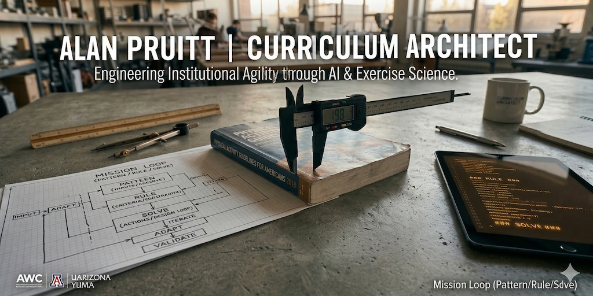

[-002147)](https://www.webcognita.com)

[-success)](https://www.w3.org/WAI/standards-guidelines/wcag/)

# Alan Pruitt (Coach Alan) — Founder & Principal, Webcognita LLC | Curriculum Architect & Sovereign AI Strategist

I am **Alan Lee Pruitt, B.S. ("Coach Alan")**, Founder, Principal & Chief Curriculum Architect of **[Webcognita LLC](https://www.webcognita.com/)** (`SDVOSB / VOSB` • `SAM.gov UEI: EZ34U9KNJA17` • `CAGE: 4ZCN6` • `Primary NAICS: 541511`), Exercise Science Adjunct Faculty at **Arizona Western College (`AWC`)**, and pro bono Generative AI Strategist & Designated Campus Colleague (`DCC`) at **The University of Arizona — School of Nutritional Sciences and Wellness (Yuma Campus)**.

I pioneer **Curriculum-as-Code (`S-A-R Standard v2.2` — Scalable / Auditable / Repeatable)**, **Compliance-as-Code (`ADA Title II` / `WCAG 2.2 AA 9:1` / `WCAG 3.0`)**, **DOM GraphRAG (`3,265` pedagogical graph nodes)**, **W3C PROV-O** cryptographic provenance, and air-gapped **Apple Silicon Edge AI** running open-weight Google **Gemini Carbon 4** and **Gemma 4** models grounded in primary federal and scientific Single Sources of Truth (`SSoT`).

*"Stop writing for the printer, and start writing for the web."*

---

## Executive & Procurement Directory

- **Research Observatory & 40-Essay Corpus:** [https://alanpruitt.com/](https://alanpruitt.com/) ([Español / Norteño-Spanish](https://alanpruitt.com/es/)) • [92-Entry Master Research Log](https://alanpruitt.com/research-log/)
- **Webcognita LLC (`SDVOSB / VOSB`):** [https://www.webcognita.com/](https://www.webcognita.com/) • [1-Page Federal Capabilities Statement](https://www.webcognita.com/capabilities-statement.html) ([PDF](https://www.webcognita.com/assets/Webcognita_LLC_Capabilities_Statement.pdf)) • [2-Page ATS Principal Resume / CV (`FAR 15.305`)](https://www.webcognita.com/principal-qualifications.html) ([PDF](https://www.webcognita.com/docs/Webcognita_LLC_Principal_Qualifications_CV.pdf))
- **Origin White Paper 00 (`Tech. Report S-A-R-v2.2-ORIGIN`):** [From Infrastructure Automation to Clinical Pedagogy: The Origin and Evolution of Curriculum-as-Code (2018–2026)](https://alanpruitt.com/curriculum-as-code/) ([2-Page PDF](https://alanpruitt.com/docs/Curriculum-as-Code-Origin-and-Evolution-Whitepaper.pdf))
- **Google Developer Profile & Substack:** [g.dev/alanpruitt](https://me.developers.google.com/u/alanpruitt) • [linkedin.com/in/alanpruitt](https://www.linkedin.com/in/alanpruitt/) • [alanpruitt.substack.com](https://alanpruitt.substack.com/)

---

## Professional Identity, Education, Cleared Pedigree & Honors

- **Founder & Principal Consultant** | **[Webcognita LLC](https://www.webcognita.com/)** (`SDVOSB / VOSB` • `SAM.gov UEI: EZ34U9KNJA17` • `CAGE: 4ZCN6` • `EIN: 81-0809739` • `NAICS: 541511, 541512, 541715, 611710, 541690` • `PSC: U008, U012, DA01, DJ01, R425, AN12`)
- **Exercise Science Adjunct Faculty (`EXW`)** | **Arizona Western College** (Hispanic-Serving Institution — Yuma, AZ / Imperial Valley, CA)
- **Generative AI Strategist & Designated Campus Colleague (`DCC`)** | **The University of Arizona** — School of Nutritional Sciences and Wellness (Yuma Campus)
- **Education:** **Bachelor of Science in Management (B.S.)** — *University of Phoenix — Phoenix, AZ*
- **Cleared Security Pedigree:** **U.S. Marine Corps (`USMC`) & U.S. Army Counterintelligence (`CI`) Veteran** with a documented background holding a **Top Secret / SCI (`SI/TK`) security clearance** and leading elite 15-person **Technical Surveillance Countermeasures (`TSCM`)** operations.
- **Verified 4-Credential Google Stack ([`g.dev/alanpruitt`](https://me.developers.google.com/u/alanpruitt)):**
  - **[Google Gemini Certified Faculty](https://edu.google.accredible.com/22b51965-eadb-4477-a9ac-1b1e2c4a45f2)** (*Blockchain `0x34c3d7...` • Valid May 2026–May 2029*)
  - **[Google Prompting Essentials Specialization](https://www.coursera.org/account/accomplishments/specialization/O9RXI0U3M59A)** (*Coursera `O9RXI0U3M59A`* — Versioning & CaC)
  - **[Google AI Professional Certificate](https://www.coursera.org/account/accomplishments/professional-cert/TIASZGL7JPG0)** (*Coursera `TIASZGL7JPG0`* — Web/PWA Design & Responsible AI)
  - **[Applying Project Management in the Real World](https://www.coursera.org/account/accomplishments/verify/U4TEVAXZBRNC)** (*Coursera `U4TEVAXZBRNC`* — Project Scoping & Quality Management)
  - Accepted Cohort Member, **Google Cloud Launchpad for Veterans**
- **Federal, National & Military Recognition:**
  - **2025 U.S. SBA *Arizona Veteran Small Business Champion of the Year*** ([AWC SBDC Official Feature PDF](https://www.azwestern.edu/sites/default/files/awc/sbdc/stories/Alan%20Pruitt.pdf))
  - **2023 U.S. Department of Commerce (`MBDA`) *Champion of Minority Business Development — Advocate of the Year*** (Quechan Indian Tribe Economic Development Specialist)
  - **2021 NADO *Aliceann Wohlbruck Impact Award*** (for an open-source GitHub AI Co-Pilot & Python API screen-reader HTML `CEDS` as 15-year WAEDD Executive Director; profiled in the [U.S. EDA StatsAmerica Q3 2021 User Spotlight](https://www.statsamerica.org/newsletter/2021Q3.aspx))
  - **Arizona SBDC *Center of Excellence Award*** (`2x` AWC SBDC Counselor & Federal `WIOA` Curriculum Specialist)
  - **1992 *Navy Commendation Medal*** (Superior Information & Physical Security Management, Pacific Theater)

---

## The Clinical Framing Protocol (`Pattern / Rule / Solve` • `Patrón / Regla / Solución`)

Under **The Centaur Protocol**, students train as **Problem Framers (Architect / Pilot)** while AI serves as the **Clinical Calculator (Engine)**:

1. **Pattern (Context / Patrón):** Diagnose regional client biometrics, movement presentation, and Yuma / Imperial Valley environmental heat stressors (`###CASE_DATA_START###` ... `###CASE_DATA_END###` local delimiter isolation).
2. **Rule (Constraint / Regla):** Verify safety gates and calculations against primary Academic Single Sources of Truth (`PAGA 2018 2nd Ed.`, `DGA 2025–2030`, `ACSM 12th Ed. 2025`, `NASM OPT Model`, and `U.S. DOL ETA TEN No. 07-25` AI Literacy Framework).
3. **Solve (Intervention / Solución):** Execute an evidence-based prescription and 150-word human Active Verification defense evaluated on the **10-7-0 Mastery Grading Scale** (`allowed_attempts = -1` unlimited revisions).

---

## Featured Public Repositories & 8-App Sovereign PWA Ecosystem

### 1. [webcognita](https://github.com/alanpruitt/webcognita) (`https://www.webcognita.com/`)
**Sovereign AI Strategy, Curriculum-as-Code & 50-State Non-Competing Enabling Resource (`SDVOSB / VOSB`)**
- **Pattern:** Institutions pursuing **U.S. DOL TEN No. 07-25**, **NSF TechAccess: AI-Ready America**, and **ADA Title II (`28 CFR Part 35`)** mandates face proprietary cloud lock-in and manual LMS accessibility backlogs.
- **Rule:** Deterministic **S-A-R Standard v2.2**, `WCAG 2.2 AA (9:1)` + `WCAG 3.0` CI/CD pre-commit gates, and verified federal procurement standing (`UEI: EZ34U9KNJA17` • `CAGE: 4ZCN6`).
- **Solve:** Turnkey Curriculum-as-Code compilers, air-gapped Apple Silicon Edge AI (`Ollama` / `Gemini Carbon 4` / `Gemma 4`), and Food Informatics R&D.

### 2. [alanpruitt.github.io](https://github.com/alanpruitt/alanpruitt.github.io) (`https://alanpruitt.com/`)
**Bilingual Curriculum-as-Code Research Observatory, 92-Entry Research Log & `$0 ZTC` OER Dataset Hub**
- **Pattern:** Fragmented, inaccessible academic portfolios and commercial textbook lock-in across K–16 dual-enrollment pipelines.
- **Rule:** `WCAG 2.2 AA (9:1 Double-Contrast Guard)` and 4-Tier `Schema.org/Dataset` + `LRMI educationalAlignment` (`CCSS` / `WA ELA` + Federal Clinical SSoTs + `US-DOL-TEN-07-25` + `HLC` outcomes).
- **Solve:** Hugo static publishing pipeline (`100/100/100/100` Lighthouse v13), `llms.txt` discovery, and SHA-256 checksummed `$0 ZTC` OER `.zip` distributions (`KIN-101`, `HLTH-150`, `KIN-210`, `KIN-245`, `KIN-265`).

### 3. [ua-nutrition-ai-tools](https://github.com/alanpruitt/ua-nutrition-ai-tools) & 8 Live Progressive Web Applications
- **[exwtoolkit.com](https://exwtoolkit.com):** 9-Box bilingual (`EN` / `ES`) clinical kinesiology, desert heat-stress, and cryptographic verification PWA.
- **[paga2018.dev](https://paga2018.dev) & [exwdemo.dev](https://exwdemo.dev):** `$0 ZTC` PAGA 2018 clinical activity audit OER and zero-login PWA mirror of public AWC Canvas Course `42051` (`256` `10/10` Exemplar Solves).
- **[flavorarchitect.dev](https://flavorarchitect.dev/) & [arquitectodelsabor.dev](https://arquitectodelsabor.dev/):** UArizona NSW Foods Lab culinary medicine & [Food Informatics](https://flavorarchitect.dev/food-informatics) R&D workbench (`DGA 2025–2030`, USDA FDC) and bi-national Arizona–Sonora (`es-MX` / `MXN`) borderlands engine.
- **[mdtodocs.app](https://mdtodocs.app), [prompt-mile-hero](https://prompt-mile-hero.lovable.app) & [agflow-roi-dash](https://agflow-roi-dash.lovable.app):** Born-accessible Markdown-to-PDF/DOCX/HTML compiler, active-transit CO2/AI compute offset utility, and Yuma/Imperial Valley 5G smart-irrigation ROI suite (plus [alanpruitt.com/edge-inat/](https://alanpruitt.com/edge-inat/) offline BioCLIP desert species computer vision).

### 4. [exw-course-resources](https://github.com/alanpruitt/exw-course-resources) & [CanvasLMS](https://github.com/alanpruitt/CanvasLMS)
- Zero-Textbook-Cost (`$0 ZTC`) Kinesiology OER components and `10-7-0` mastery rubrics ([Markdown for Faculty Cheat Sheet](./MARKDOWN_CHEAT_SHEET.md)).

---

## The Architect's Technical Stack

| Layer | Architecture & Tooling | Governing Standard |
| :--- | :--- | :--- |
| **Clinical & AI Pedagogy** | The Centaur Protocol • Clinical Framing Protocol (`Pattern / Rule / Solve`) | `U.S. DOL ETA TEN No. 07-25` • `NSF AI-Ready America` |
| **Academic SSoTs** | `PAGA 2018 (2nd Ed.)` • `DGA 2025–2030` • `ACSM 12th Ed. (2025)` • `NASM OPT` | `Achieve OER Rubrics (21/21 = 100%)` |
| **Accessibility CI/CD** | `WCAG 2.2 AA (9:1 Guard)` • `WCAG 3.0` Bilingual Plain Language (`EN` / Norteño `ES`) | `ADA Title II (28 CFR Part 35)` |
| **Edge AI & Provenance** | Antigravity IDE (`Gemini Carbon 4`) • Apple Silicon `Ollama` (`Gemma 4`) • `DOM GraphRAG` (`3,265` nodes) | `W3C PROV-O` • `W3C SKOS` • `FERPA` Zero-Egress |
| **LMS & Web Syndication** | Canvas GraphQL (`/api/graphql`) • Hugo SSG • `Schema.org` (`ProfilePage`, `Dataset`, `WebSite`) | `CC BY-NC-SA 4.0 ($0 ZTC)` |

---

## GitHub Engineering Telemetry

